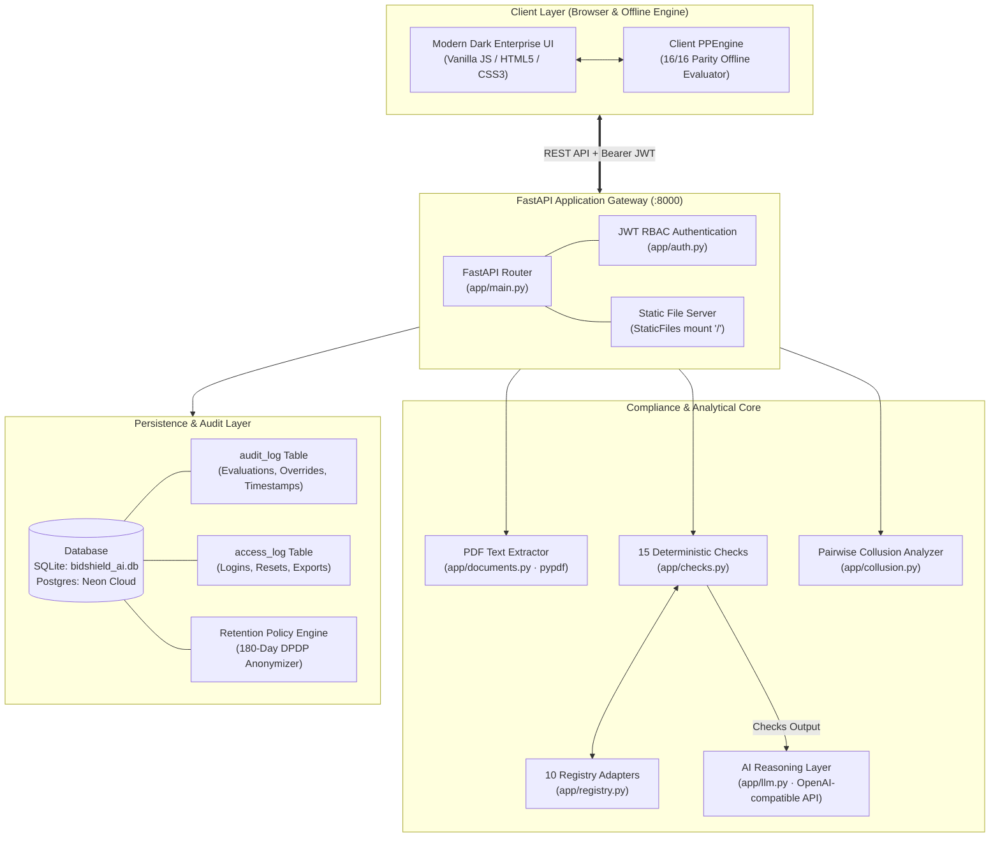
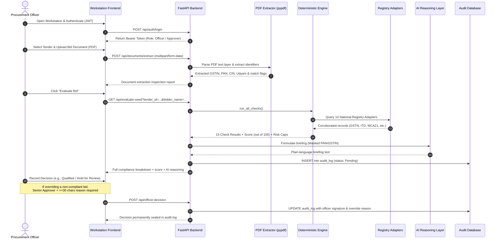
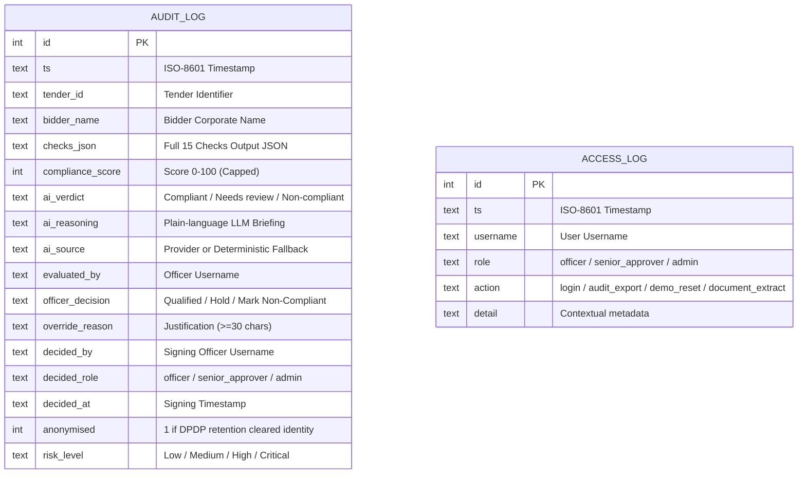

# BidShield AI — Intelligent Procurement Compliance Platform

<p align="center">
  
</p>

<p align="center">
  <a href="https://github.com/miteshlohar2005/BidShield-AI"></a>
  
  
  
  
  
  
  
</p>

<h3 align="center">
  Intelligent Procurement Compliance Platform for Government &amp; Public Sector Undertakings<br>
  <em>Code Decides. AI Explains. An Authorized Officer Signs.</em>
</h3>

<p align="center">
  <a href="#executive-summary">Executive Summary</a> &middot;
  <a href="#problem-statement--solution">Problem &amp; Solution</a> &middot;
  <a href="#system-architecture">System Architecture</a> &middot;
  <a href="#end-to-end-workflow">Workflow</a> &middot;
  <a href="#the-15-deterministic-compliance-checks">The 15 Checks</a> &middot;
  <a href="#technology-stack">Technology Stack</a> &middot;
  <a href="#features--implementation-status">Features</a> &middot;
  <a href="#project-structure">Project Structure</a> &middot;
  <a href="#installation--local-setup">Setup &amp; Run</a> &middot;
  <a href="#api-documentation">API Reference</a> &middot;
  <a href="#database--data-integrity">Data Model</a> &middot;
  <a href="#security-privacy--limitations">Security &amp; Limits</a> &middot;
  <a href="#testing--verification">Verification</a> &middot;
  <a href="#attribution--license">License</a>
</p>

---

## Executive Summary

**BidShield AI** is an intelligent procurement compliance and verification platform designed for government procurement officers and Public Sector Undertakings (PSUs). Developed for **Smart India Hackathon (SIH 2026)** problem statement **SIH26100** under the **Ministry of Petroleum & Natural Gas (MoPNG)**, the application transforms complex, multi-portal tender scrutiny into a standardized, deterministic, and auditable evaluation workflow.

In contemporary public procurement (e.g., GeM, CPPP), checking a single tender submission requires an evaluation committee to manually query 10+ disconnected national databases: GSTN, Income Tax PAN records, MCA-21 Corporate Master Data, Udyam MSME, DPIIT Startup status, NSIC, EPFO, ESIC, DigiLocker, and national debarment/blacklists. This manual process is time-consuming, inconsistent across officers, vulnerable to subtle oversight, and often leaves no tamper-evident audit trail of the decision rationale.

**BidShield AI** resolves this bottleneck with an unyielding architectural tenet:
1. **Code Decides**: 15 deterministic compliance rules execute in plain code, calculating an objective weighted score out of 100 with mandatory risk caps at 45 and 72.
2. **AI Explains**: An LLM reasoning layer synthesizes the verified rule findings into plain-language officer briefings, citing specific discrepancies without hallucinating facts.
3. **An Authorized Officer Signs**: The system acts strictly as decision support. No automated system can legally award or disqualify public tenders; named officers sign every decision on an immutable audit ledger with mandatory justification rules for overriding system recommendations.

> [!NOTE]
> **Prototype Demonstration Notice**: BidShield AI is an academic prototype developed for SIH26100. All sample tenders, bids, GSTINs, PANs, CINs, Udyam registrations, and registry databases bundled with this repository are **standardized test fixtures**. In compliance with data integrity best practices, all registry adapters are explicitly labelled as **Simulated (Demo Mode)** in the UI and API responses. Algorithmic rules (such as GSTIN Luhn check-digit validation, PAN structure decoding, and Make-in-India thresholds) execute live mathematical logic.

---

## Problem Statement & Solution

### The Procurement Compliance Challenge (SIH26100)
Public procurement officers evaluate dozens of multi-crore technical and commercial bids under strict statutory guidelines (General Financial Rules, CVC guidelines, Public Procurement Preference to Make in India orders). Today, an officer must:
- Manually open portal after portal to corroborate bidder identity and statutory standings.
- Verify whether MSME / Startup exemptions legitimately waive Earnest Money Deposits (EMD).
- Cross-examine legal names across GST certificates, PAN cards, ROC filings, and tender declarations.
- Detect subtle collusion patterns (such as identical registered addresses, tightly clustered quotes, or synchronized bid submission timestamps).

### How BidShield AI Solves It
- **Deterministic 15-Check Engine**: Eliminates human bias. The exact same bid evaluated twice produces the exact same score, risk classification, and evidentiary rationale every time.
- **Fail-Safe Score Caps**: Critical violations (active debarment, invalid GSTIN, missing mandatory statutory documents, or non-payment of EMD without valid exemption) immediately trigger a hard-cap capping the final score at **&le;45 (Critical Risk)**.
- **Privacy-Preserving AI Reasoning**: Bidder PANs and GSTINs are redacted before prompts are submitted to the LLM reasoning layer.
- **Hierarchical Governance**: Standard officers cannot override high-risk or non-compliant bids. Overriding a flagged bid requires a **Senior Approver** credential and a mandatory written justification of at least **30 characters**, permanently logged in the audit trail.

---

## System Architecture

The following diagram reflects the actual component architecture implemented across the repository:



### Component Breakdown & Responsibilities

| Component | Implementation File | Primary Responsibility | Input / Output |
|:---|:---|:---|:---|
| **Frontend Workstation** | `frontend/index.html`<br/>`scripts/template.html` | Dark enterprise UI (Steel Black `#111111`, Cyan Ash `#00E5FF`). Provides public landing page, interactive hero risk analyzer, officer login gate, tender detail views, live evaluation drawers, and audit logs. | **In:** User interactions, JWT session.<br/>**Out:** Rendered DOM, REST requests. |
| **Client Parity Engine** | `frontend/index.html` (`PPEngine`) | Pure JavaScript offline mirror of the compliance rules. Allows instant evaluation and client-side demo runs when offline. Verified against backend outputs via `scripts/parity_test.js`. | **In:** Seeded bid objects.<br/>**Out:** 15 check results, score, risk. |
| **API Application Gateway** | `backend/app/main.py` | FastAPI application exposing endpoints for auth, tenders, evaluations, document parsing, decisions, collusion checks, registries, and audit logs. | **In:** HTTP requests.<br/>**Out:** JSON API responses. |
| **Authentication & RBAC** | `backend/app/auth.py` | Issues and verifies HS256 JWT tokens. Enforces role-based permissions across three tiers: `officer`, `senior_approver`, and `admin`. Passwords hashed with PBKDF2-HMAC-SHA256 (120,000 iterations). | **In:** Login credentials.<br/>**Out:** Bearer token + role claims. |
| **Deterministic Rules Engine** | `backend/app/checks.py` | Executes the 15 compliance checks. Computes raw weighted scores, enforces hard score caps (45/72), and assigns standardized verdicts (`Compliant`, `Needs review`, `Non-compliant`). | **In:** Tender spec + bidder submission.<br/>**Out:** List of 15 check dictionaries + score breakdown. |
| **Registry Adapters** | `backend/app/registry.py` | Ten structured adapters covering GSTN, ITD PAN, MCA-21, Udyam, DPIIT, NSIC, EPFO, ESIC, DigiLocker, and Debarment. Includes live algorithmic validation for GSTIN check digits and PAN format decoding. | **In:** Bidder registration IDs.<br/>**Out:** Verification status, filing records, match ratios. |
| **Document Text Extractor** | `backend/app/documents.py` | Extracts text layers from uploaded bid PDFs using `pypdf`. Extracts and validates embedded GSTIN, PAN, Udyam, CIN, and DPIIT numbers, cross-referencing them against tender declarations. | **In:** Uploaded PDF byte stream (&le;4 MB).<br/>**Out:** Matched/mismatched identifiers. |
| **Collusion Detector** | `backend/app/collusion.py` | Performs pairwise mathematical comparisons across all bids for a given tender. Evaluates price clustering (&lt;0.5%), submission timing (&le;5 min), shared registered addresses, and abnormal cover bids (&gt;25% over benchmark). | **In:** Tender bidders dictionary.<br/>**Out:** List of statistical collusion warning signals. |
| **AI Reasoning Layer** | `backend/app/llm.py` | Formulates plain-language officer briefings. Pre-redacts sensitive identifiers (PAN/GSTIN), integrates with OpenAI-compatible endpoints (configured for Sarvam's `sarvam-105b`), with deterministic fallback if unconfigured. | **In:** Verified check results + tender spec.<br/>**Out:** AI briefing text (&le;110 words) + source tag. |
| **Persistence & Audit** | `backend/app/db.py` | Database abstraction supporting SQLite (local development) and PostgreSQL (Neon in production). Manages `audit_log` and `access_log` tables with a 180-day anonymization job. | **In:** Evaluation logs, decisions, access records.<br/>**Out:** Persistent audit history. |

---

## End-to-End Workflow



---

## The 15 Deterministic Compliance Checks

Every check is implemented in Python in [`backend/app/checks.py`](backend/app/checks.py) and mirrored in [`frontend/index.html`](frontend/index.html).

| # | Check Name | Family | Wt | Required Input / Evidence | Rule Logic & Thresholds | Outcome & Score Impact |
|:---:|:---|:---|:---:|:---|:---|:---|
| **1** | **EMD Compliance** 🔻 | Tender eligibility | 10 | Bid EMD amount, claims (MSE, Startup, NSIC), Udyam/DPIIT registries | Verifies full EMD payment against tender requirement. If zero, verifies whether bidder holds active verified exemption under Udyam or DPIIT. | **PASS** (+10 pts)<br/>**FAIL** (0 pts, **hard-cap &le;45, Critical Risk**) |
| **2** | **Statutory Documents** 🔻 | Tender eligibility | 10 | Uploaded documents list vs `required_documents` | Checks presence and DigiLocker provenance of mandatory filings (PAN card, GST cert, balance sheets, ISO). | **PASS** (+10 pts if all verified at source)<br/>**FLAG** (+5 pts if self-attested)<br/>**FAIL** (0 pts, **hard-cap &le;45, Critical Risk** if missing) |
| **3** | **Financial Turnover** | Tender eligibility | 10 | Bidder average turnover vs tender `min_turnover` | Compares audited 3-year turnover against tender baseline. | **PASS** (+10 pts if turnover &ge; minimum)<br/>**FAIL** (0 pts, score capped at &le;72) |
| **4** | **Price Reasonability** | Tender eligibility | 8 | Quoted price vs `benchmark_price` | Evaluates quote variance against benchmark estimate. | **PASS** (+8 pts if within &plusmn;12%)<br/>**FLAG** (+4 pts if abnormally low &lt;-12% or high &gt;+12%) |
| **5** | **Make in India Local Content** | Tender eligibility | 6 | Bidder declared `local_content_pct` | Classifies bidder per DPIIT Public Procurement Order. | **PASS** (+6 pts if Class-I &ge;50% or Class-II &ge;20%)<br/>**FLAG** (+3 pts if undeclared)<br/>**FAIL** (0 pts if &lt;20%) |
| **6** | **OEM Authorisation** | Tender eligibility | 6 | `is_oem` flag, OEM authorisation letter | Verifies if bidder is manufacturer or holds valid verified reseller credentials. | **PASS** (+6 pts if OEM, verified reseller, or not required)<br/>**FLAG** (+3 pts if self-attested)<br/>**FAIL** (0 pts if missing when required) |
| **7** | **GST Registration & Returns** 🔻 | Registry verification | 8 | Bidder 15-char GSTIN, GSTN filing history | Evaluates Luhn check digit algorithm, active registration status, entity name matching, and GSTR-3B filing regularity. | **PASS** (+8 pts if active and filing current)<br/>**FLAG** (+4 pts if return backlog or minor name variance)<br/>**FAIL** (0 pts, **hard-cap &le;45, Critical Risk** if cancelled or bad format) |
| **8** | **PAN & Income Tax** | Registry verification | 7 | Bidder PAN (derived from GSTIN digits 3–12), ITD filings | Corroborates entity type character (4th char: `C` Company, `P` Person, `F` Firm), name initial (5th char), and last 3 assessment years ITR status. | **PASS** (+7 pts if structure and filings verified)<br/>**FLAG** (+3.5 pts if entity mismatch or missed ITR year) |
| **9** | **MSE & Startup Status** | Registry verification | 6 | Udyam registration number, DPIIT recognition number | Queries MSME Udyam and DPIIT registries to corroborate validity of special preference claims. | **PASS** (+6 pts if claims corroborated or no benefit claimed)<br/>**FLAG** (+3 pts if declared claim fails verification) |
| **10** | **EPFO & ESIC Compliance** | Registry verification | 6 | EPFO establishment code, ESIC registration code | Mandatory for labour services tenders. Evaluates monthly challan deposit lag (&le;1 month grace allowed). | **PASS** (+6 pts if challans current or goods supply)<br/>**FLAG** (+3 pts if challans &gt;1 month behind)<br/>**FAIL** (0 pts if missing on labour tender) |
| **11** | **Entity Name Consistency** | Integrity and risk | 7 | Name across bid, PDF document text, GSTN, ITD, MCA-21 | Runs Levenshtein/gestalt similarity matching across all official records. | **PASS** (+7 pts if similarity &ge;85% across all sources)<br/>**FLAG** (+3.5 pts if name variation detected) |
| **12** | **Debarment Status** 🔻 | Integrity and risk | 8 | Bidder legal entity name against GeM / CPPP blacklist | Cross-checks national debarment and public sector exclusion registries. | **PASS** (+8 pts if clear of adverse sanctions)<br/>**FAIL** (0 pts, **hard-cap &le;45, Critical Risk** if actively debarred) |
| **13** | **Public Interest Screening** | Integrity and risk | 3 | Adverse media and regulatory sanction records | Screens for adverse regulatory observations or serious financial misconduct inquiries. | **PASS** (+3 pts if clean record)<br/>**FLAG** (+1.5 pts if adverse media record identified) |
| **14** | **Shell Company Indicators** | Integrity and risk | 3 | MCA-21 date of incorporation, tender shared addresses | Identifies red flags: incorporation &lt;91 days before bidding, inactive ROC status, or registered address sharing with a competing bidder. | **PASS** (+3 pts if established &gt;90 days and unique address)<br/>**FLAG** (+1.5 pts if young entity or shared address) |
| **15** | **Past Performance History** | Integrity and risk | 2 | Platform `audit_log` records across earlier tenders | Inspects historical decisions across previous PSU tenders recorded in the system database. | **PASS** (+2 pts if clean history or first-time bidder)<br/>**FLAG** (+1 pt if prior "Mark Non-Compliant" decisions found) |

> 🔻 **Hard Score Cap Rules**:
> - Any `FAIL` on checks 1, 2, 7, or 12 enforces a **maximum score cap of 45** and assigns **Critical Risk**.
> - Any `FAIL` on other checks enforces a **maximum score cap of 72** and assigns **High Risk**.
> - Any `FLAG` assigns **Medium Risk** (unless already capped at High/Critical).
> - All `PASS` assigns **Low Risk** and **Compliant** verdict.

---

## Technology Stack

| Category | Technology | Version | Purpose in BidShield AI |
|:---|:---|:---:|:---|
| **Backend Framework** | **Python** / **FastAPI** | 3.11+ / `0.115.6` | Asynchronous high-performance REST API gateway, dependency injection, and static frontend mounting. |
| **ASGI Server** | **Uvicorn** | `0.32.1` | Production ASGI web server with reload capabilities. |
| **Data Validation** | **Pydantic** | `2.10.4` | Strict schema validation for login requests, decision payloads, and system models. |
| **Authentication** | **PyJWT** | `2.10.1` | Cryptographic HS256 JSON Web Token issuance and claims verification. |
| **PDF Processing** | **pypdf** | `5.1.0` | Extracting raw text streams from uploaded tender documents for automated regex identification. |
| **Database Drivers** | **sqlite3** / **psycopg3** | Built-in / `3.2.3` | Dual-mode persistence: zero-config SQLite for local runs; PostgreSQL with binary drivers for Neon cloud deployments. |
| **Environment Management** | **python-dotenv** | `1.0.1` | Automated loading of configuration from local `.env` files. |
| **Frontend Architecture** | **Vanilla HTML5 / Modern CSS / ES6 JavaScript** | Native | Ultra-fast single-page interface with dark enterprise design tokens, SVG data visualizations, and zero runtime build steps. |
| **Motion & Animation** | **GSAP** (Optional) | `3.12.5` | Optional smooth hardware-accelerated UI transitions (gracefully falls back if offline). |
| **Testing & QA** | **Pytest** / **HTTPX** / **Selenium** | `8.3.4` / `0.28.1` / `4.x` | Unit testing, API route integration testing, client-backend parity verification, and automated browser workflow tests. |

---

## Features & Implementation Status

### ✅ Implemented & Fully Operational
- [x] **15 Deterministic Compliance Checks**: Full rule evaluation with exact mathematical weights and score deduction tracing.
- [x] **Multi-Tier Risk Classification**: Automatic calculation of `Low`, `Medium`, `High`, and `Critical` risk levels with hard score caps.
- [x] **PDF Text Extraction & Cross-Verification**: Live regex extraction of GSTIN, PAN, Udyam, CIN, and DPIIT numbers from PDF text layers.
- [x] **Collusion Detection Engine**: Pairwise multi-factor analysis detecting price clustering (&lt;0.5%), submission intervals (&le;5 min), shared addresses, and cover bids (&gt;25%).
- [x] **Role-Based Workstation Access**: Three-tier security (`officer`, `senior_approver`, `admin`) with PBKDF2 credential hashing.
- [x] **Senior Approver Override Rule**: Enforces senior approver authorization and &ge;30-character written justifications to qualify non-compliant bids.
- [x] **Complete Dual-Storage Database**: Automatic switching between SQLite (`bidshield_ai.db`) and PostgreSQL (`DATABASE_URL`).
- [x] **Data Protection & Retention Policy**: Automated DPDP-compliant anonymization job clearing commercial identifiers from records older than 180 days.
- [x] **Admin Export & Access Audit**: Permanent logging of sign-ins, demo resets, and encrypted JSON audit log exports.
- [x] **Client-Server Parity Engine**: Pure JavaScript engine in the frontend matching 16/16 backend evaluation scenarios identically.
- [x] **Interactive Hero Risk Analyzer**: Real-time interactive procurement risk gauge and sample bid inspection module on the public landing page.

### 🟡 Partially Implemented / Demo Mode
- [x] **Registry Adapters**: 10 adapters structured with live validation rules (Luhn algorithm, PAN format decoding); external HTTP calls query standardized test fixtures (`MODE: simulated`).
- [x] **AI Reasoning Layer**: Fully implemented provider-agnostic LLM caller with identifier masking. Connects to OpenAI-compatible endpoints when `LLM_API_KEY` is provided; automatically falls back to deterministic rule summaries when unconfigured.

### 📋 Planned (Future Roadmap)
- [ ] **OCR Engine for Scanned Documents**: Integration of Tesseract / EasyOCR to parse non-digital, scanned physical PDF submissions.
- [ ] **Live Government API Gateways**: Direct production integration with API Setu, GeM API, and GST Suvidha Providers (GSP) under official institutional onboarding.
- [ ] **CPSE Production Pilot**: Trial deployment in a sandboxed public enterprise procurement environment.

---

## Project Structure

```
procurement-pilot/
├── backend/
│   ├── app/
│   │   ├── __init__.py
│   │   ├── auth.py              # JWT authentication & role enforcement (officer, approver, admin)
│   │   ├── checks.py            # 15 deterministic compliance checks, score calculation & caps
│   │   ├── collusion.py         # Pairwise cross-bid collusion & price clustering screen
│   │   ├── data.py              # Sample tenders, bidders, and simulated registry datasets
│   │   ├── db.py                # Database connector (SQLite / Postgres), retention & access logs
│   │   ├── documents.py         # PDF text extraction & identifier cross-verification
│   │   ├── llm.py               # AI reasoning layer with PII masking & deterministic fallback
│   │   ├── main.py              # FastAPI application gateway, routes, static file mount
│   │   └── registry.py          # 10 national registry adapters & GSTIN/PAN algorithmic rules
│   ├── tests/
│   │   ├── __init__.py
│   │   └── test_api.py          # Complete Pytest test suite (26 passing integration tests)
│   ├── requirements.txt         # Production runtime dependencies
│   └── requirements-dev.txt     # Development and testing dependencies
├── frontend/
│   ├── index.html               # Compiled production frontend (landing portal + workstation)
│   ├── team-logo.png            # Official team branding asset
│   └── samples/                 # Sample bid documents for live document reader verification
│       ├── sample_bid_petrotech.pdf
│       ├── sample_bid_trident.pdf
│       └── sample_bid_vantage.pdf
├── scripts/
│   ├── build_frontend.py        # Frontend build script injecting seed & engine into template
│   ├── dump_backend.py          # Generates test JSON of backend evaluations across all bids
│   ├── parity_test.js           # Validates 100% parity between client JS engine and Python evaluator
│   ├── sync_seed.py             # Synchronizes data.py fixtures with client engine seed data
│   ├── template.html            # Master frontend template (source of truth for frontend updates)
│   └── test_browser_ws.py       # Automated Selenium Chrome Headless workstation test suite
├── assets/
│   └── readme/                  # High-resolution README graphics and media assets
│       ├── hero.svg             # Animated dark enterprise hero graphic
│       ├── divider.svg          # Stylized section divider
│       ├── flow.svg             # High-level bid flow diagram
│       ├── score.svg            # Score weighting and risk cap illustration
│       ├── video.jpg            # Demo video thumbnail
│       └── walkthrough.gif      # Live application walkthrough recording
├── docs/
│   └── REPO_SCOPE.md            # Detailed documentation on repository scope and lineage
├── .env.example                 # Reference environment variables configuration
├── LICENSE                      # MIT Open-Source License
├── pyproject.toml               # Python project configuration and Vercel build manifest
└── render.yaml                  # Alternative cloud deployment blueprint for Render
```

---

## Installation & Local Setup

### Prerequisites
- **Python**: Version `3.11` or higher (`python --version`)
- **Node.js**: Version `18` or higher (optional, required only for parity test `node scripts/parity_test.js`)
- **Google Chrome**: (Optional, required only for running the headless Selenium browser test suite)

### 1. Clone the Repository
```bash
git clone https://github.com/miteshlohar2005/BidShield-AI.git
cd BidShield-AI
```

### 2. Set Up Python Virtual Environment

#### On Windows (PowerShell):
```powershell
python -m venv .venv
.\.venv\Scripts\Activate.ps1
python -m pip install --upgrade pip
pip install -r backend/requirements.txt -r backend/requirements-dev.txt
```

#### On Linux / macOS (Bash):
```bash
python3 -m venv .venv
source .venv/bin/activate
python -m pip install --upgrade pip
pip install -r backend/requirements.txt -r backend/requirements-dev.txt
```

### 3. Configure Environment Variables
Copy the example environment file:
```bash
cp .env.example backend/.env
```
Default settings run immediately using SQLite with zero external dependencies.

To enable the optional live AI reasoning layer, configure an OpenAI-compatible API key in `backend/.env`:
```env
LLM_BASE_URL=https://api.sarvam.ai/v1
LLM_MODEL=sarvam-105b
LLM_API_KEY=your_sarvam_api_key_here
LLM_REASONING_EFFORT=none
```

### 4. Start the Application
Run the backend server from the workspace root:
```bash
python -m uvicorn backend.app.main:app --host 127.0.0.1 --port 8000 --reload
```
Once started, the application is live at:
👉 **`http://127.0.0.1:8000`**

### 5. Access the Officer Workstation
Click **"Open Workstation &rarr;"** on the landing page or navigate directly to `http://127.0.0.1:8000/#workstation`.

Use any of the built-in demo credentials (or click the quick-fill buttons in the login gate):
| Username | Password | Role | Permissions |
|:---|:---|:---|:---|
| `officer1` | `officer123` | **Officer** | Run evaluations, upload documents, record standard decisions, view audit logs. |
| `approver1` | `approver123` | **Senior Approver** | Everything an officer can do + **authorize written overrides (&ge;30 chars)** on non-compliant bids. |
| `admin1` | `admin123` | **Administrator** | Everything + **export encrypted audit logs**, run retention jobs, and reset test data. |

---

## API Documentation

Interactive OpenAPI / Swagger documentation is available at **`http://127.0.0.1:8000/docs`** (and ReDoc at **`http://127.0.0.1:8000/redoc`**).

| Method | Endpoint | Auth | Role Required | Description & Response |
|:---:|:---|:---:|:---:|:---|
| `GET` | `/api/health` | Public | None | Returns system health, database dialect (`sqlite` or `postgres`), active check counts, and reasoning layer status. |
| `POST` | `/api/auth/login` | Public | None | Accepts `{"username": "...", "password": "..."}`. Returns Bearer JWT token with TTL and role claims. |
| `GET` | `/api/auth/me` | JWT | Any signed-in | Returns current authenticated user profile and assigned role. |
| `GET` | `/api/tenders` | JWT | Any signed-in | Returns list of open tenders with sanitized bidder summaries and benchmark specifications. |
| `GET` | `/api/evaluate-seed` | JWT | Any signed-in | Parameters: `tender_id`, `bidder_name`. Executes all 15 checks, computes weighted score, risk caps, and returns AI reasoning. |
| `POST` | `/api/documents/extract` | JWT | Any signed-in | Multipart form: `tender_id`, `bidder_name`, `file` (PDF &le;4 MB). Extracts embedded identifiers and cross-references against tender declarations. |
| `POST` | `/api/officer-decision` | JWT | Any signed-in | Records official officer disposition. If qualifying a non-compliant bid, enforces senior approver role and &ge;30-character justification. |
| `GET` | `/api/collusion-check` | JWT | Any signed-in | Parameter: `tender_id`. Runs pairwise statistical collusion checks (price clustering, submission timing, address sharing). |
| `GET` | `/api/registries` | JWT | Any signed-in | Returns metadata and status for all 10 national registry integration adapters. |
| `GET` | `/api/audit-log` | JWT | Any signed-in | Returns complete audit trail of tender evaluations, scores, verdicts, and signed officer decisions. |
| `GET` | `/api/audit-log/export` | JWT | **Admin** | Exports full audit logs along with historical system access logs. The export event itself is audited. |
| `POST` | `/api/admin/retention` | JWT | **Admin** | Executes DPDP compliance cleanup, irreversibly anonymizing commercial identities older than 180 days while retaining score metrics. |
| `POST` | `/api/admin/reset-demo` | JWT | **Admin** | Clears evaluation logs prior to a demonstration session. The reset action is permanently preserved in `access_log`. |

---

## Database & Data Integrity

BidShield AI employs an abstract storage layer compatible with SQLite for local development and PostgreSQL for production environments.

### Entity Relationship Diagram



### Data Protection & DPDP Compliance
- **Storage Limitation**: Under India's Digital Personal Data Protection (DPDP) principles, bids evaluated older than `RETENTION_DAYS` (default: 180 days) have their `bidder_name`, `checks_json`, and free-text fields anonymized:
  `UPDATE audit_log SET bidder_name = 'Anonymised Bidder [hash]', checks_json = '[]', ai_reasoning = '', anonymised = 1 WHERE ts < cutoff`.
- **Integrity Survival**: Statistical metrics (compliance scores, risk levels, and timestamps) are preserved, ensuring administrative analytics continue to function without indefinitely storing sensitive corporate filings.

---

## Security, Privacy & Limitations

### Verified Security Controls
1. **Role-Based Access Control (RBAC)**: Enforced cryptographically on the server via HS256 JWT tokens. Standard officers cannot invoke administrative endpoints or execute approval overrides.
2. **Password Security**: Passwords are never stored in plaintext. Passwords are cryptographically verified using PBKDF2 with SHA-256 and unique 16-byte random salts.
3. **PII Masking**: In [`backend/app/llm.py`](backend/app/llm.py), commercial identifiers (GSTINs and PANs) are redacted before prompt payloads are dispatched to external AI reasoning providers.
4. **File Safety**: The PDF document extraction endpoint strictly enforces a 4 MB file limit (`MAX_BYTES`) and validates the `%PDF` binary header before delegating to `pypdf`.
5. **Audit Traceability**: Key administrative events (logins, PDF extractions, audit exports, and demo resets) are logged to the `access_log` table.

### Known Limitations
- **Scanned Documents**: The current build reads digital text layers from PDF files using `pypdf`. Scanned physical documents lacking a text stream require an OCR pipeline (planned for future phases).
- **Simulated Registry Responses**: As an academic hackathon prototype, external registry lookups query standardized mock datasets. Production deployment requires institutional agreements with API Setu, GSTN GSPs, and GeM.
- **Decision Authority**: BidShield AI provides **decision support**. Statistical flags and risk scores do not constitute legal proof of collusion or fraud; an authorized government officer must independently review evidentiary records before executing an official decision.

---

## Testing & Verification

The repository maintains automated verification suites spanning backend unit tests, client-engine parity, and headless browser tests.

### 1. Backend Pytest Suite (26 Tests)
Runs API endpoint tests, authentication checks, hard score cap rules, startup exemptions, and retention jobs:
```bash
pytest backend/tests/test_api.py -v
```
**Result**: `26 passed in 2.21s` (100% passing).

### 2. Client-to-Backend Parity Suite (16 Scenarios)
Verifies that the client-side JavaScript engine (`PPEngine`) produces the identical score, risk level, and check status as the backend Python evaluator across every tender and bidder:
```bash
python -c "import subprocess, os; out = subprocess.check_output(['python', 'scripts/dump_backend.py']); open('dump.json', 'wb').write(out); res = subprocess.run(['node', 'scripts/parity_test.js', 'dump.json']); os.remove('dump.json'); exit(res.returncode)"
```
**Result**: `16/16 cases match the backend` (100% parity).

### 3. Automated End-to-End Browser Test
Tests the full browser workflow using Selenium Chrome Headless against the live running server:
```bash
python scripts/test_browser_ws.py
```
**Verified Actions**:
- Homepage hero section and interactive risk gauge render.
- Navbar and Hero "Open Workstation" button activations.
- Sign-in modal display and URL hash updating (`#workstation`).
- Demo officer and senior approver authentication.
- Tender sidebar selection and detail rendering.
- 15-check compliance evaluation drawer execution.
- Browser Back/Forward hash state navigation.

---

## Attribution & License

### Hackathon Attribution
- **Event**: Smart India Hackathon 2026 (SIH 2026)
- **Problem Statement**: SIH26100
- **Ministry**: Ministry of Petroleum & Natural Gas (MoPNG)
- **Institution**: ACE Engineering College, Hyderabad
- **Team**: **Team Ace Azael**
- **Repository Maintainer**: [Mitesh Lohar](https://github.com/miteshlohar2005)

### Original Lineage
BidShield AI is developed from the foundation of the SIH26100 procurement compliance prototype by [Chintha Victor Isaac](https://github.com/victorisaacchinta-eng).

### License
This project is open-source software licensed under the **MIT License**. See the [`LICENSE`](LICENSE) file for complete details. Third-party libraries and dependencies remain the intellectual property of their respective maintainers under their applicable licenses.
